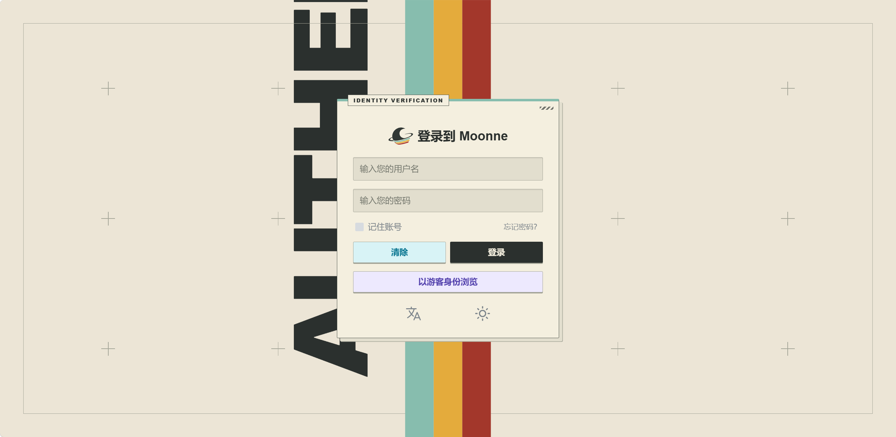
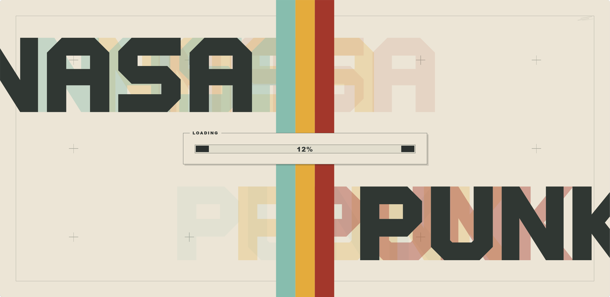
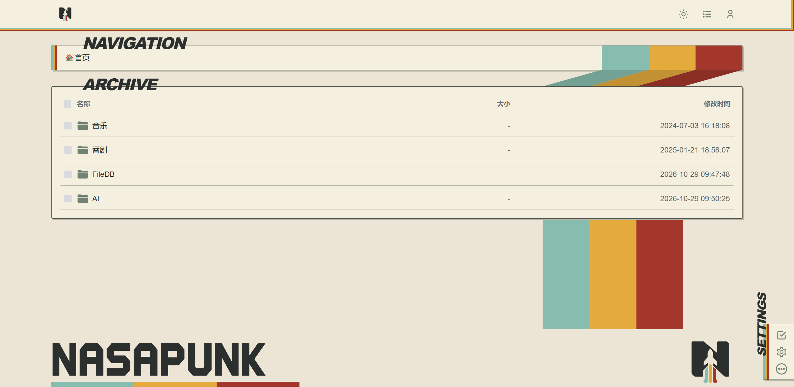
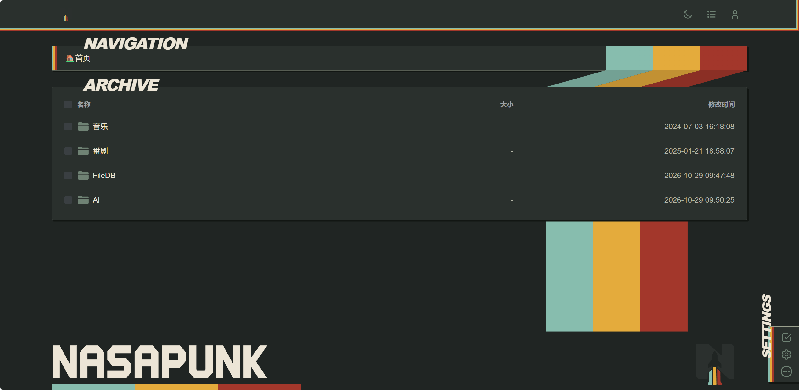
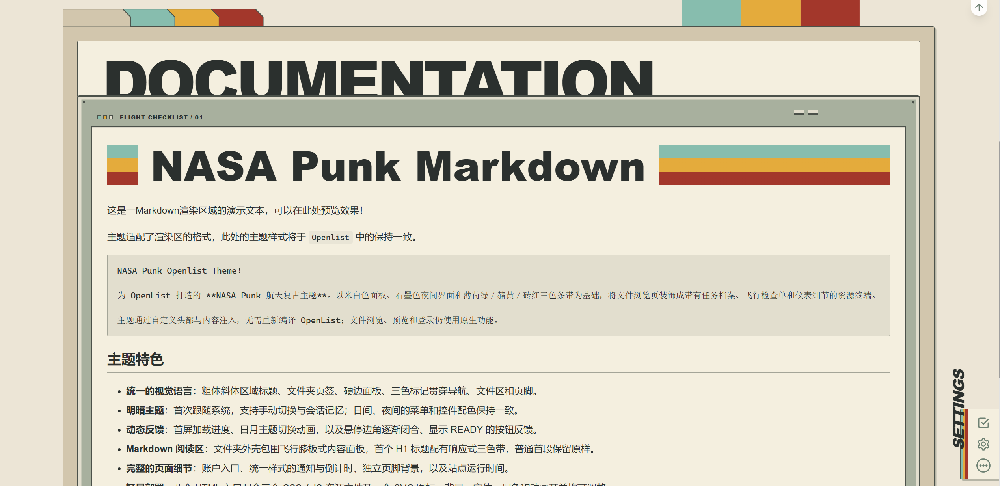

<p align="center">
  
</p>


# OpenList NASA Punk Theme

为 OpenList 打造的 **NASA Punk 航天复古主题**。以米白色面板、石墨色夜间界面和薄荷绿／赭黄／砖红三色条带为基础，将文件浏览页装饰成带有任务档案、飞行检查单和仪表细节的资源终端。

主题通过自定义头部与内容注入，无需重新编译 OpenList；文件浏览、预览和登录仍使用原生功能。

## 主题特色

- **统一的视觉语言**：粗体斜体区域标题、文件夹页签、硬边面板、三色标记贯穿导航、文件区和页脚。
- **明暗主题**：首次跟随系统，支持手动切换与会话记忆；日间、夜间的菜单和控件配色保持一致。
- **等高线背景**：纯色主页面可显示立体地形、逐层扫描和整体轻微视差，支持关闭并适配减少动态效果设置。
- **动态反馈**：首屏加载进度、日月主题切换动画，以及悬停边角逐渐闭合、显示 READY 的按钮反馈。
- **Markdown 阅读区**：文件夹外壳包围飞行膝板式内容面板，首个 H1 标题配有响应式三色带，普通首段保留原样。
- **完整的页面细节**：账户入口、统一样式的通知与倒计时、独立页脚背景，以及站点运行时间。
- **轻量部署**：两个 HTML 入口配合三个 CSS／JS 资源文件及一个 SVG 图标，背景、字体、配色和动画开关均可调整。

## 效果预览

|              登录页               |                加载页                 |
| :-------------------------------: | :-----------------------------------: |
|  |  |

|                    日间主题                     |                      夜间主题                       |
| :---------------------------------------------: | :-------------------------------------------------: |
|  |  |

|              Markdown样式               |
| :-------------------------------------: |
|  |


## 快速使用

**使用默认主题无需 Fork，也无需自行上传 CSS 或 JS。**

1. 打开本仓库的 [nasapunk_head.html](nasapunk_head.html)，点击 **Raw**，复制完整内容，粘贴到 OpenList 设置中的「自定义头部」。
2. 打开 [nasapunk_body.html](nasapunk_body.html)，同样复制完整内容，粘贴到「自定义内容」。
3. 保存并刷新前台页面。如果已有其他主题，请替换旧代码，不要叠加。

首屏加载遮罩的样式和启动逻辑内联在 head 中，其余资源通过 CDN 加载。head 已配置本仓库的 jsDelivr 地址：

```text
https://cdn.jsdelivr.net/gh/Moonnne/openlist_nasapunk_theme@main/src
```

默认使用 NASAPUNK 字标与纯色背景，运行时间默认隐藏。需要设置自己的品牌、背景和站点信息时，请按下面的 Fork 流程操作。顶栏、登录页 Logo 和 favicon 默认沿用 OpenList 配置；页脚右侧大 Logo 独立使用仓库内的 `src/nasapunk-icon.svg`，随 CDN 基址自动加载。

## 可选参数

可在 head 的 `window.NASAPUNK_CONFIG` 中找到主要开关：

| 参数 | 用途 |
| --- | --- |
| `logoUrl` | 顶栏、登录页 Logo 与 favicon；默认留空，沿用 OpenList |
| `footerLogoUrl` | 页脚右侧大 Logo，默认 `nasapunk-icon.svg` |
| `terrainBackground` | 纯色主页面等高线背景，默认开启 |
| `pageTransitions` / `themeTransitions` | 页面／明暗切换动画 |
| `pageRibbon` | 向下贯穿内容区的三色带 |
| `selectionUnderline` | 文字选区下划线效果 |
| `backgrounds.main` / `backgrounds.footer` | 主区域／页脚背景图与颜色 |
| `loading` | 首屏动画开关与等待时间 |
| `startedAt` | 站点运行时间起点 |
| `userIconUrl` | 账户图标地址 |

默认跟随系统主题；手动切换后在当前标签页会话中记忆，刷新保留。完整参数、字体和颜色变量见 [DEV.md](docs/DEV.md)。

填写示例（修改 head 中对应项目）：

```js
logoUrl: "",                // 沿用 OpenList 图标
footerLogoUrl: "nasapunk-icon.svg", // 页脚使用主题图形
terrainBackground: false,   // 关闭等高线背景
themeTransitions: false,     // 关闭明暗切换动画
pageRibbon: false,           // 关闭贯穿色带
startedAt: "2026-01-01T00:00:00+08:00", // 从示例日期计算运行时间
```

完整配置对象、背景图、字体、配色和自定义图标示例见 [DEV.md](docs/DEV.md)。

## Fork 与自定义

1. **Fork [本仓库](https://github.com/Moonnne/openlist_nasapunk_theme)** 到自己的 GitHub 账户。
2. **在自己的仓库中修改文件**：
   - `nasapunk_head.html`：背景、字体、配色、动画开关等参数。
   - `nasapunk_body.html`：页脚文字、链接与 Logo。
   - `src/`：进一步修改布局、装饰和交互逻辑。
3. **修改自己 head 中的 `assetBase`**，把用户名、仓库名替换为自己的信息：

   ```js
   assetBase: "https://cdn.jsdelivr.net/gh/你的用户名/你的仓库@main/src"
   ```

4. **提交修改后，复制自己仓库中的 head 和 body**，替换 OpenList 中的两段代码并刷新。保留 `src/` 目录结构；只改源码却不改 `assetBase`，页面仍会加载原仓库的资源。

希望固定版本时，可把 URL 中的 `main` 替换为自己仓库已有的版本标签或提交 SHA。jsDelivr 存在缓存，正式更新推荐使用新版本地址；仅替换入口内容不会自动刷新同地址的 CDN 缓存。

顶栏、登录页和 favicon 由 `logoUrl` 控制；页脚大 Logo 由 `footerLogoUrl` 独立控制。文章三色带使用 Markdown 首个非空 H1（`# 标题`）；没有 H1 时不生成文章标题带。

资源结构、字体接入、参数详情和开发验证流程见 **[DEV.md](docs/DEV.md)**。
